<!--
  ADITYA.OS — self-hosted animated profile. No third-party image services.
  Every SVG in /assets is regenerated from live GitHub data by .github/workflows/refresh.yml
-->

<div align="center">

<sub><code>ADITYA.OS</code> &nbsp;·&nbsp; <code>yuvadi29</code> &nbsp;·&nbsp; <code>● LIVE</code></sub>

<a href="https://adityatrivedi.in/">
  
</a>

<p>
  <a href="https://adityatrivedi.in/"></a>
  <a href="https://github.com/yuvadi29?tab=repositories"></a>
  <a href="https://github.com/yuvadi29?tab=followers"></a>
  <!-- add your socials here, same style:
  <a href="https://youtube.com/@YOUR_HANDLE"></a>
  <a href="https://linkedin.com/in/YOUR_HANDLE"></a>
  <a href="https://x.com/YOUR_HANDLE"></a>
  -->
</p>

</div>

<h3><code>❯ cat ~/about.md</code></h3>

<table>
<tr>
<td width="62%" valign="top">

I teach, I build, and I write about both. I run a **15k+ developer community** and spend most of my time in **JavaScript** and **TypeScript**, turning hard ideas into things people can actually use.

```js
const aditya = {
  base:      "Bengaluru, IN",
  roles:     ["educator", "developer", "author"],
  shipping:  ["PromptOS", "Second-Brain"],
  teaching:  ["GitHub Actions", "Redis", "System design"],
  wantsTo:   "work with people who care about craft, context & shipping the useful version",
};
```

</td>
<td width="38%" valign="top">

<pre>
<b>process</b>     aditya
<b>status</b>      ● online
<b>focus</b>       JS · TS · CSS
<b>community</b>   15k+ devs
<b>mode</b>        build → teach → repeat
<b>coffee</b>      ████████░░ 80%
</pre>

</td>
</tr>
</table>

<h3><code>❯ htop</code></h3>



<h3><code>❯ ps aux | grep shipped</code></h3>



<p align="center">
  <a href="https://github.com/Yuvadi29/PromptOS"><kbd>./PromptOS</kbd></a> &nbsp;
  <a href="https://github.com/Yuvadi29/Second-Brain"><kbd>./Second-Brain</kbd></a> &nbsp;
  <a href="https://github.com/Yuvadi29/Github-Actions-Series"><kbd>./Github-Actions-Series</kbd></a> &nbsp;
  <a href="https://github.com/Yuvadi29/Redis"><kbd>./Redis</kbd></a>
</p>

<h3><code>❯ pkg install --from-repos</code></h3>



<h3><code>❯ tail -f /var/log/commits</code></h3>



<details>
<summary><code>❯ sudo cat /etc/secrets</code> &nbsp;<sub>(you found a hidden process)</sub></summary>

<br />

```diff
+ Permission granted. Welcome, curious one.
+ If you read this far, you're exactly who I like building with.
- rm -rf ./doubts
+ git commit -m "say hi to aditya" && git push origin friendship
```

</details>

<br />

<div align="center">
  <a href="https://adityatrivedi.in/">
    
  </a>
  <sub><code>ADITYA.OS</code> · rebuilt every 6 hours from live GitHub data · <code>exit 0</code></sub>
</div>
